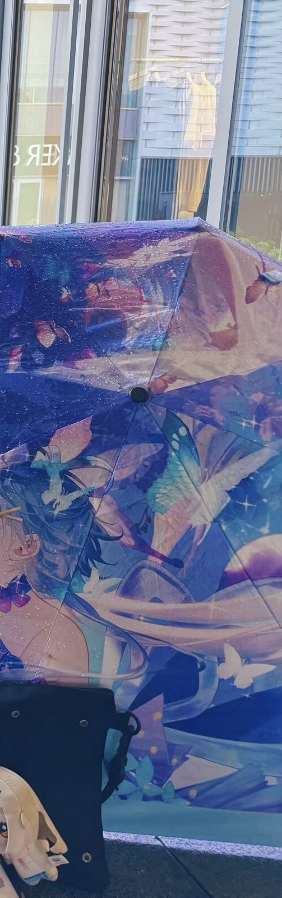
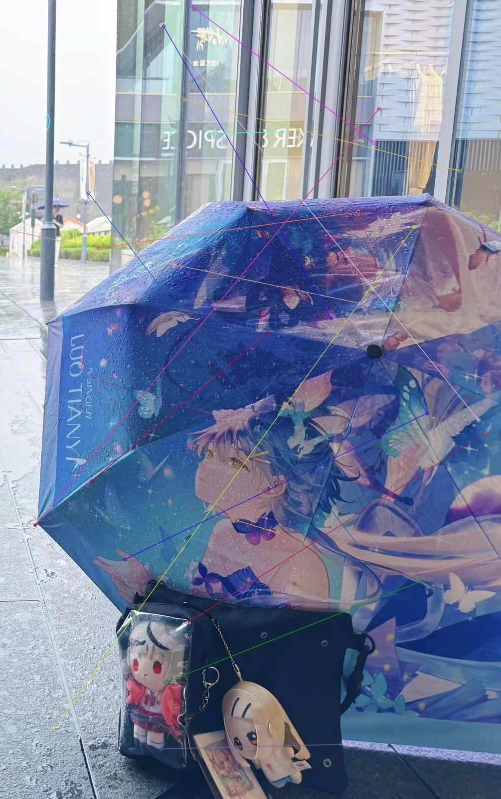
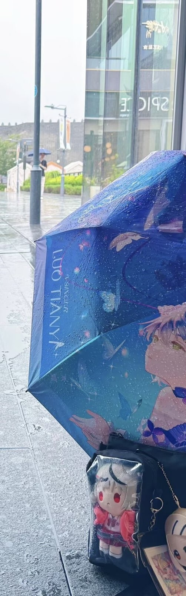

# 实验3 图像拼接

##  ⼀、实验⽬的

学会OpenCV的基本使用方法，掌握图像特征提取与匹配的基本流程；利用SIFT检测关键点并提取描述符，使用FLANN匹配器进行特征匹配，通过Lowe's比率测试筛选优质匹配点，使用RANSAC算法估计单应矩阵，结合透视变换实现两幅图像的拼接。


## 二、实验内容

### 2.1 导⼊图像拼接相关的库

* 1.OpenCV库：计算机视觉与图像处理
* 2.NumPy库：科学计算的基础库

```python
import cv2
import numpy as np
```

### 2.2 读取原始图像并转换为灰度图

读取本地的图片并转换为灰度图

```python
img_a = cv2.imread('../img/a.jpg')
img_b = cv2.imread('../img/b.jpg')
gray_a = cv2.cvtColor(img_a,cv2.COLOR_BGR2GRAY)
gray_b = cv2.cvtColor(img_b,cv2.COLOR_BGR2GRAY)
```

原图（img.jpg）


裁剪后的左图（a.jpg）


裁剪后的右图（b.jpg）




### 2.3使用SIFT检测器提取特征

```python
sift = cv2.SIFT_create()
kp_a, des_a = sift.detectAndCompute(gray_a,None)
kp_b, des_b = sift.detectAndCompute(gray_b,None)
```


### 2.4使用FLANN匹配器进行特征匹配

```python
index_params = dict(algorithm=1,trees=5)
search_params = dict(checks=50)
flann = cv2.FlannBasedMatcher(index_params,search_params)
matches = flann.knnMatch(des_a,des_b,k=2)
```

### 2.5 应用Lowe's比率测试筛选优质匹配点

```python
good_matches = []
for m,n in matches:
    if m.distance < 0.7*n.distance:
        good_matches.append(m)
```

### 2.6 绘制匹配的SIFT关键点

```python
matched_keypoints_img = cv2.drawMatches(
    img_a,kp_a,img_b,kp_b,good_matches,
    None,flags=cv2.DrawMatchesFlags_NOT_DRAW_SINGLE_POINTS
)
```

### 2.7使用RANSAC算法估计单应矩阵

```python
src_pts = np.float32([kp_b[m.trainIdx].pt for m in good_matches]).reshape(-1,1,2)
dst_pts = np.float32([kp_a[m.queryIdx].pt for m in good_matches]).reshape(-1,1,2)

H,_ = cv2.findHomography(src_pts,dst_pts,cv2.RANSAC,5.0)
```

### 2.8计算拼接后图像尺寸与平移矩阵

```python
h_a,w_a = img_a.shape[:2]
h_b,w_b = img_b.shape[:2]

pts = np.float32([[0,0],[0,h_b],[w_b,h_b]]).reshape(-1,1,2)
dst_corners = cv2.perspectiveTransform(pts,H)
all_corners = np.concatenate([dst_corners,np.float32([[0,0],[w_a,0],[w_a,h_a],[0,h_a]]).reshape(-1,1,2)],axis=0)
[x_min,y_min] = np.int32(all_corners.min(axis=0).ravel()-0.5)
[x_max,y_max] = np.int32(all_corners.max(axis=0).ravel()+0.5)
translation_matrix = np.array([[1,0,-x_min],[0,1,-y_min],[0,0,1]],dtype=np.float32)
```


### 2.9对图像b进行透视变换并拼接图像a

```python
stitched_img = cv2.warpPerspective(
    img_b,
    translation_matrix @ H,
    (x_max-x_min,y_max-y_min)
)
stitched_img[-y_min:h_a-y_min,-x_min:w_a-x_min] = img_a
```


### 2.10 显示与保存拼接结果

```python
cv2.imwrite('../img/matched_keypoints_img.jpg', matched_keypoints_img)
cv2.imwrite('../img/stitched_img.jpg', stitched_img)
cv2.imshow('matched keypoint', matched_keypoints_img)
cv2.imshow('result', stitched_img)
cv2.waitKey(0)
cv2.destroyAllWindows()
```

结果如图所示

matched_keypoints_img




stitched_img




## 三、实验小结

本次实验使用了SIFT，FLANN匹配器等算法进行了图像匹配与拼接，并使用相关api进行了可视化处理


